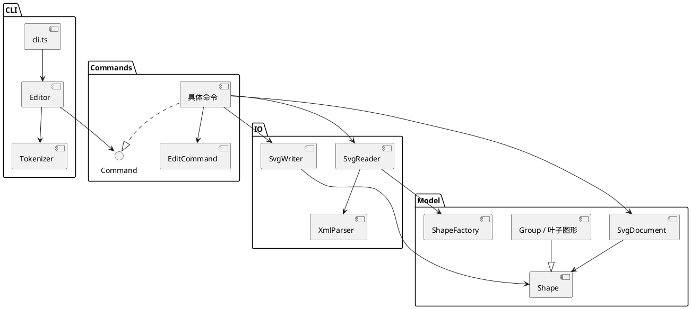

# Lab1 Phase 1：SVG 编辑器 CLI

Git 仓库地址：[https://github.com/Crychic123/lab1.git](https://github.com/Crychic123/lab1.git)

# 架构方案

## 模块划分

| 目录或文件 | 职责 |
|---|---|
| `src/model/` | `Shape` 抽象类、六种具体图形、`SvgDocument` 容器关系与不变量、`ShapeFactory` 类型构造。图形对象封装几何属性与移动、缩放、属性设置、显示摘要。 |
| `src/commands/` | 每条命令一个类。编辑命令继承 `EditCommand`，一条命令完成一次原子编辑并形成一次撤销单元。文档类与显示类命令实现同一 `Command` 接口。 |
| `src/io/` | XML 解析、SVG 读入与写出。读入验证格式和唯一 id，写出 XML 转义并保留层级。 |
| `src/Editor.ts`、`src/Tokenizer.ts`、`src/cli.ts` | 依次负责命令分发和历史栈、双引号参数切分、终端逐行交互。 |
| `test/` | 面向会话的行为测试：组合、撤销、文件往返、失败原子性。 |

## 设计模式的选择与落地

**Command 模式**：`Editor` 将命令名映射到 `Command` 类，一次输入创建一个命令对象。编辑命令的 `perform()` 只修改文档副本；成功后 `EditCommand.execute()` 将前后快照保存于命令对象并交给 `Editor` 的历史栈。`undo()` / `redo()` 从同一命令对象恢复快照。因此 `group`、`ungroup` 等多处结构改动也是单个撤销单元；失败时副本被丢弃，当前文档与历史都不变。文档类操作清空并锁定历史，下一次成功编辑重新解锁。

**Composite 模式**：`Group` 与叶子类均继承 `Shape`。`Group.move()` 和 `Group.scale()` 递归调用子图形的同名方法；删除、分组与恢复操作处理整棵子树。命令只依赖 `Shape` 的多态接口，无须按图形类型写操作分支。`ShapeFactory` 负责类型名到构造逻辑的映射。

两处按名字分派保留为后续重构点：`Editor` 的命令注册表，以及 `ShapeFactory` 的图形类型注册表。插件阶段可把固定注册表改为外部注册接口；本阶段不实现 `box`。

## 依赖方向规则

- `model` 不依赖 `commands`、`io` 或 CLI；模型可独立用于未来图形界面或 agent。
- `io` 只依赖 `model`，将 SVG 文本转换为模型或反向转换；模型不知道文件格式与文件路径操作。
- `commands` 可以依赖 `model`，文件命令可以依赖 `io`；命令不依赖终端输入输出。
- `Editor` 依赖命令接口和注册的具体命令；`cli.ts` 只依赖 `Editor`，不直接修改图形。

`commands` 中的命令需要调用 `Editor` 的文档与历史接口，因此存在 TypeScript 的仅类型引用（`import type`）。运行时依赖仍由 `Editor` 指向具体命令。若未来扩展到多前端，可把这组窄接口抽到独立的应用层。

## 变化点假设

1. **新图形类型**：最可能新增 `box` 等复合图形。已将几何行为放在 `Shape` 子类，创建集中在 `ShapeFactory`；插件注册接口留待后续阶段，此处没有提前实现不要求的插件系统。
2. **新命令**：每条命令一个类，注册点集中在 `Editor`。未来添加命令时可复用编辑快照与错误处理；外部注册暂不实现。
3. **SVG 格式兼容范围**：读写隔离在 `io`，模型不依赖 XML。当前解析器只支持任务涉及的元素与部分常用属性和简单变换；复杂 SVG 功能可通过替换读写模块扩展。
4. **撤销存储方式**：目前每个成功编辑保存整份文档前后快照，逻辑简单且易保证原子性。若文档显著增大，可改为各命令保存局部逆操作或结构共享；第一阶段不为此增加复杂度。

# 过程记录

- 初始仓库为空，先依据任务规格建立六种图形和 `Group` 统一接口，再补命令、读写和 CLI。选择直接修改子图形几何属性实现容器移动/缩放，以满足题目要求的递归语义。
- 实现撤销时检查到 `group` 会同时改动多个父容器。如果在原文档上逐步执行，失败可能留下半成品，因此改成在深拷贝上执行，成功后一次替换文档；测试验证失败的分组和非法 `set` 不改变树或历史。
- SVG 往返测试发现 XML 实体解码把 `&amp;` 解出后又错误地当作未知实体检查。改为单次扫描、单次解码，回归测试覆盖文字 `A & B`。
- 复查面向对象约定时，移动命令最初通过具体类型判断来拼反馈坐标；改为 `Shape.position()` 多态方法，将类型差异留在图形类内部。
- 对 `box` 的阶段边界作了取舍：按第一阶段规格返回 `unknown shape type`，文档只记录未来插件位置，不提前写死内核实现。

# 一致性自查

1. **模块划分**：实际的 `src/model/`、`src/commands/`、`src/io/`、CLI 入口和 `test/` 与上面的方案一致，无未记录的目录偏差。
2. **依赖方向**：抽查 `Shape.ts`、`SvgDocument.ts` 只引用模型类；`SvgReader.ts` / `SvgWriter.ts` 只引用模型与解析器；具体命令引用模型及必要的 IO；`cli.ts` 只引用 `Editor`。`import type` 的应用层接口引用已在规则中注明。没有发现模型反向依赖 IO/命令的情况。

# 质量保证手段

`npm test` 覆盖典型流程图构建、容器递归移动、创建时归属、组合与解散、z-order、删除恢复、撤销/重做分支、保存/读取往返、自动补 id、简单变换、带空格文本与非法输入的原子性。`npm run typecheck` 使用严格 TypeScript 检查。CLI 还通过标准输入回放了命令会话，确认反馈、树形结构和保存后的撤销限制。测试通过只能证明这些支持范围内的行为；复杂 SVG 元素、非等比和旋转变换以及插件图形属于后续扩展范围。
